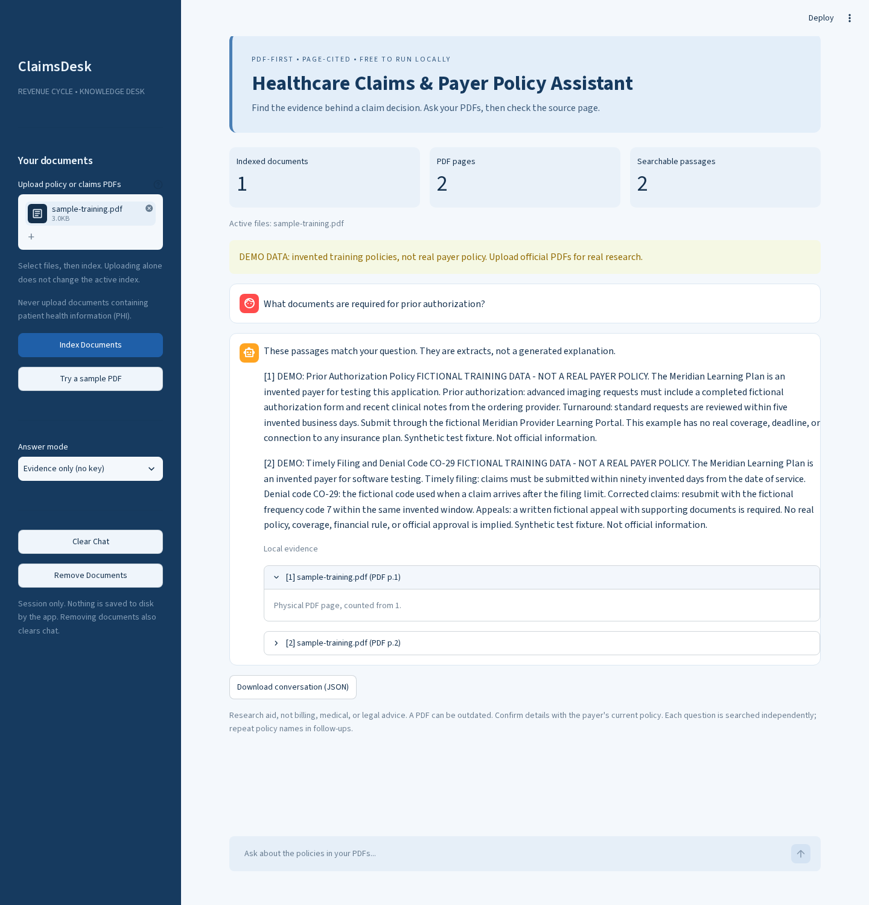

# ClaimsDesk: Healthcare Claims & Payer Policy Assistant

An original PDF question-answering app by Mahaboob Basha. Upload payer policy or claims manual PDFs, index their text locally, ask questions, and inspect the matching excerpts with **filename and physical PDF page** citations. Built for revenue cycle management (RCM) work: prior authorization rules, timely filing limits, denial codes, coordination of benefits, and required documentation.



> The screenshot and bundled sample use invented training policies, not real payer policy. Add official, current policy PDFs for actual research. This is not billing, medical, or legal advice. **Never upload documents containing patient health information (PHI).**

## Live demo (Vercel)

https://claimsdesk.vercel.app is a static, in-browser port (folder `web/`): PDFs are read and searched in your browser with pdf.js and never uploaded. It offers evidence-only answers. The Streamlit app (`app.py`) adds the optional Ollama and Groq modes.

## Quick start (no key, no account)

Requires Python 3.10+ (tested on Python 3.10).

```bash
git clone https://github.com/mbasha661/healthcare-claims-assistant.git
cd healthcare-claims-assistant
python -m venv .venv
```

Activate the environment:

```bash
# macOS / Linux
source .venv/bin/activate
# Windows PowerShell
.venv\Scripts\Activate.ps1
```

Then:

```bash
python -m pip install -r requirements.txt
python -m streamlit run app.py --server.address 127.0.0.1
```

Open the local URL shown in your terminal, usually http://localhost:8501.

1. Select **Try a sample PDF** for a two-page fictional demo, or upload your own text PDFs.
2. For uploaded files, select **Index Documents**. A successful index replaces the previous documents and chat. A failed index leaves them unchanged.
3. Ask: `What documents are required for prior authorization?`
4. Expand a source to inspect the evidence. The answer should point to PDF page 1. Ask about the timely filing limit to exercise page 2.
5. Use **Clear Chat** to keep documents but remove messages. **Remove Documents** clears both. Download a JSON conversation if needed.

## Try it with a real public policy PDF

Validated against the CMS *Medicare Claims Processing Manual*, Chapter 1 (a public PDF from cms.gov). Download a chapter PDF from https://www.cms.gov/regulations-and-guidance/guidance/manuals/internet-only-manuals-ioms-items/cms018912 and index it, then ask for example `What is the timely filing limit for Medicare claims?` The app returns matching passages with their physical PDF page numbers. English policy text extracts cleanly; scanned PDFs need OCR first.

## Answer modes and costs

| Mode | Setup | Data handling | Output |
|---|---|---|---|
| Evidence only (default) | None | Local, no API requests | Matching extracts, not an LLM-generated answer |
| Ollama (local) | Install Ollama and download a model | Question and excerpts sent only to `127.0.0.1:11434` | Generated explanation with citation checks |
| Groq (optional cloud) | Your own free-tier Groq key | Explicit checkbox required before sending question + retrieved excerpts to Groq | Generated explanation, subject to provider limits |

The default is deliberately usable offline after installing dependencies. It uses **local sparse TF-IDF embeddings**, combining word and character features, not a pretrained neural embedding model. It works best with the same language and exact policy terms used in the PDF. It is not cross-language semantic search.

No paid API is required. This app cannot check your Groq account's billing plan. Use only a free account, do not enable paid billing, and expect quotas/model availability to change. Failed requests fall back to local evidence. Model calls are never made in the default mode.

### Local generated answers with Ollama

Install Ollama separately from its official site. On the same computer as Streamlit:

```bash
ollama pull qwen2.5:3b
```

Restart the app and select **Ollama (local)**. Questions and retrieved excerpts go only to the loopback address `127.0.0.1:11434`.

## Privacy and safety

- PDFs are read in memory for the session only. The app writes nothing to disk.
- Cloud generation is off by default and needs an explicit checkbox each time.
- Never upload documents with patient health information (PHI) or member data. Use de-identified or public payer policy documents only.
- Excerpts inside PDFs are treated as untrusted text, not instructions, and the generated answer must cite excerpts by number or the app falls back to local evidence.

## Development

```bash
python -m pip install -r requirements-dev.txt
python scripts/make_sample.py   # regenerate the fictional fixture
python -m pytest tests -q       # retrieval and citation tests
python scripts/ui_smoke.py      # optional browser smoke check, needs playwright install
```

`docs/demo.png` and `docs/mobile.png` are produced by the smoke check.

## Background

Adapted from the author's [Uzhavan agriculture schemes assistant](https://github.com/mbasha661/uzhavan-scheme-assistant), rebuilt for the healthcare revenue cycle domain to pair with his RCM work experience (Billed Right, Vee Technologies, Omega Healthcare).
